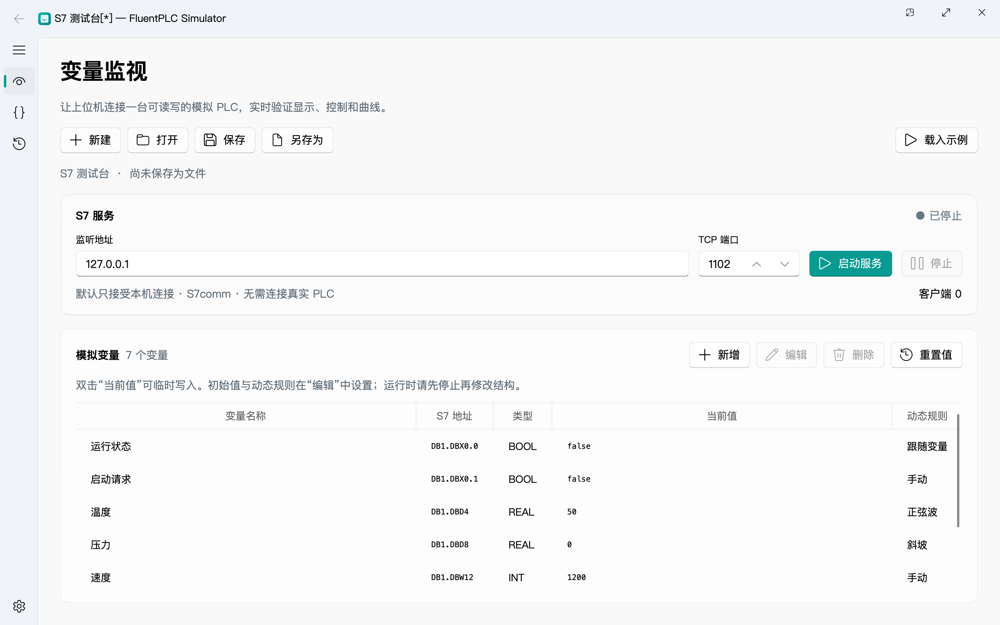

# FluentPLC Simulator



用于 HMI 联调的 C++ / Qt S7 通信模拟器。桌面程序提供变量与规则的操作界面，命令行程序运行同一套模拟内核；外部 S7 客户端通过真实 Snap7 服务读取、写入内存。

这是通信模拟与轻量信号规则工具，不执行 STEP 7 / TIA Portal 工程或梯形图，不等同于西门子 PLCSIM。支持范围以本仓库实现和测试为准。

## 快速开始

构建依赖：Qt **6.12**（Core、Gui、Widgets、Svg、Network、Test）、CMake 3.21+、Ninja 和支持 C++17 的编译器。Snap7 与 FluentQtWidgets 以 Git 子模块固定源码版本，不需要另装系统 Snap7。

Snap7 固定于官方源码 commit `30f37da3114024a71ba93f7fd855c680b97a406f`。macOS 构建在构建目录的副本应用 [兼容补丁](patches/snap7-macos.patch)，修正单调时钟和断连时 SIGPIPE 处理；不会直接修改子模块。来源与许可证见 [第三方说明](THIRD_PARTY_NOTICES.md)。

在仓库根目录执行：

```sh
git submodule update --init --recursive
cmake --preset debug -DCMAKE_PREFIX_PATH=/你的/Qt/6.12.0/对应平台目录
cmake --build --preset debug
ctest --preset debug
```

macOS 的 Qt 目录通常以 `macos` 结尾；Windows 在对应 Qt 编译器环境中运行，选择匹配的 `msvc*_64` 目录。Release 构建使用 `cmake --preset release` 和 `cmake --build --preset release`。具体构建和打包验证记录见 [测试说明](docs/testing.md)。

启动桌面目标 `FluentPLCSimulator`，打开 [HMI 联调示例](examples/hmi-demo.plcsim.json)，再启动模拟服务。也可以从构建目录运行命令行目标：

```sh
./build/debug/FluentPLCServer \
  --project examples/hmi-demo.plcsim.json \
  --listen 127.0.0.1 --port 1102 --duration 30
```

省略 `--duration` 会持续运行；省略 `--project` 使用程序内置示例。Windows 使用对应的 `.exe`。桌面目标在 macOS 上是 `.app` 包，可从 Finder 启动；命令行目标是独立可执行文件。

只校验工程不启动监听：

```sh
./build/debug/FluentPLCServer --project examples/hmi-demo.plcsim.json --check
./build/debug/FluentPLCServer --write-demo /tmp/builtin-demo.plcsim.json
```

## HMI 连接参数

| 参数 | 本机示例值 |
|---|---|
| 协议 | 经典 S7comm / ISO-on-TCP |
| PLC 地址 | `127.0.0.1` |
| 端口 | `1102` |
| Rack / Slot | `0` / `1` |
| 数字字节序 | Siemens 大端 |

默认使用非特权端口 `1102`，不需要以管理员身份占用 PLC 常用的 `102`。HMI 客户端必须允许配置端口。在另一台电脑上连接时，服务绑定地址和 HMI 目标地址都应改成模拟器电脑可达的网卡 IP。

示例工程的变量如下。变量地址中的数字是**字节偏移**；例如 REAL 占四字节，因此 `DBD0` 与 `DBD4` 不重叠。

| 地址 | 类型 | 用途 / 行为 |
|---|---|---|
| `DB1.DBX0.0` | BOOL | 运行状态，跟随启动请求 |
| `DB1.DBX0.1` | BOOL | 启动请求，初始 false，保留 HMI 或界面写入的值 |
| `DB1.DBD4` | REAL | 温度，初始 50；20–80 的正弦信号，周期 10 秒 |
| `DB1.DBD8` | REAL | 压力，初始 0；0–10 的斜坡信号，周期 10 秒 |
| `DB1.DBW12` | INT | 速度设定值，初始 1200；保留 HMI 或界面写入的值 |
| `M0.0` | BOOL | 心跳，初始 false，每秒翻转 |
| `Q0.0` | BOOL | 跟随启动请求的输出状态 |

把 HMI 仪表绑定 `DB1.DBD4 / REAL`，输入框写入 `DB1.DBW12 / INT`，开关写入 `DB1.DBX0.1 / BOOL`，指示灯读取 `DB1.DBX0.0 / BOOL`，即可检查采集、写回和反馈。程序内置示例与上面的示例文件一致。此表描述通用连接方式，并不代表现有 HMI 产品已经实现 S7 控件或工程导出。

## 模拟规则与保存

`manual` 保留内存当前值；采集 tick 不会把它恢复成初始值。`sine` 和 `ramp` 按时间生成数值；`toggle` 每半周期翻转 BOOL；`follow` 从另一个相同类型的已定义地址复制值。生成或跟随规则会在后续 tick 更新其目标，所以需要持久手动写入的目标应设为 `manual`。

停止与重新启动服务保留当前内存。加载/应用工程会按 `initialValue` 重新初始化；运行中不能替换工程。工程保存的是配置与初始值，不是 PLC 运行快照。

工程扩展名约定为 `.plcsim.json`；格式独立于 HMI 的 `.uidp`。DB、M、I、Q 各区域的内存来自工程的 `memorySize`，只有工程中出现的 DB 会注册。变量表是这些区域中命名的视图，外部客户端仍能访问已注册区域内没有命名的字节。地址越界、变量重叠、未知类型、无效规则、缺失跟随来源和跟随循环会被拒绝。详见 [工程格式](docs/project-format.md)。

## 验证范围与许可证

自动化测试使用真实 `TS7Client` 连接本机随机高端口，覆盖网络读写、BOOL 位写保留邻位、规则反馈、工程校验和生命周期。两端都使用 Snap7，因此还应使用独立实现的客户端进行交叉验证，例如纯 Python 的 `python-snap7` 3.x；其具体 API 和位写行为需按固定版本确认。测试不需要真实 PLC。

应用代码采用 GPL-3.0；原生 Snap7 采用 LGPL-3.0-or-later，保留其独立许可证及固定子模块来源。分发时应连同本项目许可证、Snap7 许可证和相应源码信息一起提供。当前平台的实际构建、桌面启动及跨实现客户端验证状态在 [测试说明](docs/testing.md) 中单独记录；没有记录的项目不能视为已经验证。
