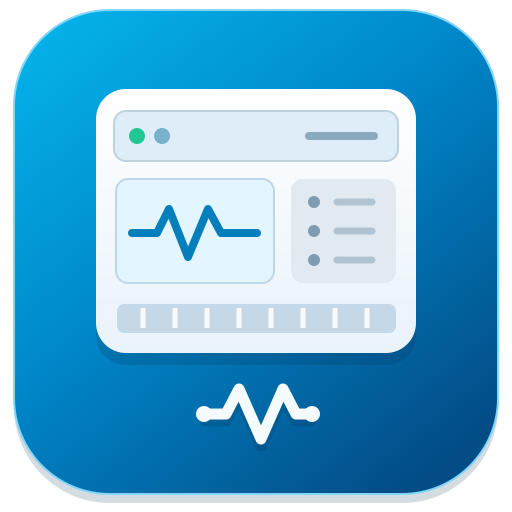
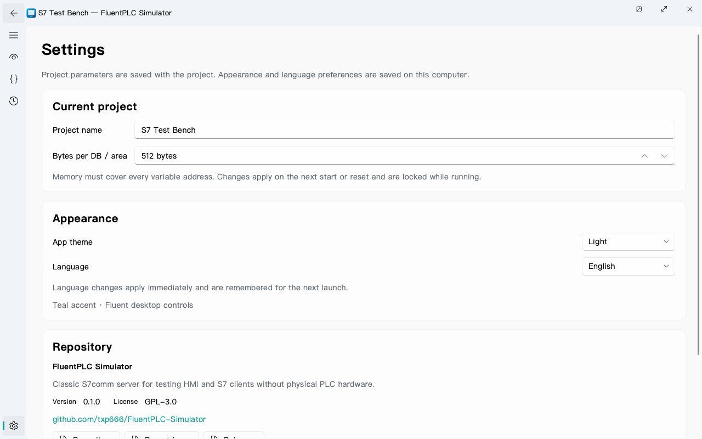

<p align="center">
  
  <h1 align="center">FluentPLC Simulator</h1>
  <p align="center">A C++ S7 communication simulator for hardware engineers · built on <a href="https://github.com/txp666/FluentQtWidgets">FluentQtWidgets</a> and <a href="https://github.com/davenardella/snap7">Snap7</a></p>
  <p align="center">English · <a href="README_zh.md">简体中文</a> · <a href="examples/hmi-demo.plcsim.json">Example project</a> · <a href="docs/project-format.md">Project format</a> · <a href="docs/testing.md">Validation</a></p>
</p>

FluentPLC Simulator is the independent S7 communication testing tool in the [modusignal](https://github.com/txp666/modusignal) tool family. Edit variables, current values and lightweight signal rules in a desktop UI, or run the same simulation core from the CLI. External S7 clients read and write DB, M, I and Q memory through a real Snap7 server.

It simulates classic S7comm communication; it does not execute STEP 7 / TIA Portal projects or ladder logic and is not Siemens PLCSIM. It uses its own `.plcsim.json` projects. FluentHMI Studio and PyQt UI Designer 0.7.0 support classic S7 clients in preview and exported applications; the browser-based modusignal editor does not support S7.

> **Settings**: Language offers Follow system (default), English and 简体中文. Theme offers Follow system (default), Light and Dark.

These preferences are saved on this computer and apply immediately while preserving the running session and its values.

## Screenshots

Monitor variables, edit live values, configure signal rules and control the server from one desktop app:

<picture><source media="(prefers-color-scheme: dark)" srcset="docs/images/main-window-dark.png"></picture>

The Settings page includes appearance, language, repository information and related tools:



## Features

- **Real S7 server**: classic S7comm / ISO-on-TCP with a configurable address and port; the desktop app and headless executable share one core.
- **Typed memory**: BOOL, BYTE, SINT, WORD, INT, DWORD, DINT and REAL, encoded in Siemens big-endian order; BOOL bit writes preserve neighbouring bits.
- **Lightweight rules**: manual, sine, ramp, toggle and follow, with ordered feedback evaluation and validation of addresses, types, overlaps and dependency cycles.
- **Separate projects and live values**: save configuration and initial values, edit current memory, preserve memory across stop/start, and restore initial values when applying a project.

## Building

Requires CMake 3.21+, C++17, Ninja and **Qt 6.12** (Core, Gui, Widgets, Svg, Network and Test). Snap7 and FluentQtWidgets are pinned Git submodules; no system Snap7 installation is required. In the repository root:

```bash
git submodule update --init --recursive
cmake --preset debug
cmake --build --preset debug
ctest --preset debug
```

Qt is discovered in the usual installer locations. For another location, add `-DCMAKE_PREFIX_PATH=<qt-dir>` to the configure command. On Windows, use the matching Qt/MSVC developer environment. For a Release build, use the `release` configure and build presets. See [Validation](docs/testing.md) for the platforms and artifacts actually checked.

Open `build/debug/FluentPLCSimulator.app` on macOS, or the `FluentPLCSimulator` executable on your platform. The service starts stopped. Open the [example project](examples/hmi-demo.plcsim.json), then start the server; the same project is also built into the app.

## Headless server

```bash
./build/debug/FluentPLCServer \
  --project examples/hmi-demo.plcsim.json \
  --listen 127.0.0.1 --port 1102 --duration 30
```

Omit `--duration` to keep running, or omit `--project` to use the built-in example. On Windows, use the corresponding `.exe`. Validate a project without listening, or write out the built-in example:

```bash
./build/debug/FluentPLCServer --project examples/hmi-demo.plcsim.json --check
./build/debug/FluentPLCServer --write-demo /tmp/builtin-demo.plcsim.json
```

## S7 client connection

| Setting | Local example |
| --- | --- |
| Protocol | Classic S7comm / ISO-on-TCP |
| PLC address | `127.0.0.1` |
| TCP port | `1102` |
| Rack / slot | `0` / `1` |
| Numeric byte order | Siemens big-endian |

The default unprivileged port `1102` avoids requiring administrator access to the usual PLC port `102`; your client must allow a configurable port. To connect from another computer, bind the service to a reachable interface and use that computer's IP address in the client.

The canonical example contains these variables. Address offsets are in **bytes**; REAL uses four bytes.

| Address | Type | Behaviour |
| --- | --- | --- |
| `DB1.DBX0.0` | BOOL | Running status; follows the start request |
| `DB1.DBX0.1` | BOOL | Start request; initially false, preserves client or UI writes |
| `DB1.DBD4` | REAL | Temperature; initially 50, sine wave from 20 to 80 with a 10-second period |
| `DB1.DBD8` | REAL | Pressure; initially 0, ramp from 0 to 10 with a 10-second period |
| `DB1.DBW12` | INT | Speed setpoint; initially 1200, preserves client or UI writes |
| `M0.0` | BOOL | Heartbeat; initially false, flips every second |
| `Q0.0` | BOOL | Output status; follows the start request |

In FluentHMI Studio or PyQt UI Designer 0.7.0, add an S7 connection card with the settings above. Bind a gauge to `DB1.DBD4 / REAL`, write an input to `DB1.DBW12 / INT`, write a switch to `DB1.DBX0.1 / BOOL`, and read its feedback from `DB1.DBX0.0 / BOOL`. See the [C++ S7 setup](https://github.com/txp666/FluentHMI-Studio/blob/v0.7.0/docs/s7.md) or [Python S7 setup](https://github.com/txp666/PyQt-UI-Designer/blob/v0.7.0/docs/s7.md).

## Rules and project files

`manual` leaves current memory unchanged, so ticks do not restore its initial value. `sine` and `ramp` generate numeric signals, `toggle` flips a BOOL every half-period, and `follow` copies a named address of the same type. Generated and following tags are updated on later ticks; use `manual` for values that should retain client writes.

Stopping and restarting preserves current memory. Applying or loading a project initializes its memory from `initialValue`; a running server must be stopped before its project is replaced. Saving writes configuration and initial values, rather than a live memory snapshot.

Projects use `.plcsim.json`, separate from HMI `.uidp` files. `memorySize` sets the size of each registered area/DB; only DBs used in the project are registered. Named tags are views into those areas, and clients can access unnamed bytes inside registered areas too. Invalid addresses, out-of-range values, overlaps, unknown types or rules, missing follow sources and dependency cycles are rejected. See the [project format](docs/project-format.md).

## Related projects

| Project | Role |
| --- | --- |
| [FluentHMI Studio](https://github.com/txp666/FluentHMI-Studio) | Native C++/Qt 6 HMI designer with standalone runtime export |
| [PyQt UI Designer](https://github.com/txp666/PyQt-UI-Designer) | Python/PyQt5 HMI designer with editable Python source export and Nuitka packaging |
| [modusignal](https://github.com/txp666/modusignal) | Browser device debugger and `.uidp` Custom Device editor, within browser transport limits |
| [FluentPLC Simulator](https://github.com/txp666/FluentPLC-Simulator) | Independent desktop and CLI classic S7comm server for testing S7 clients |

The HMI tools share `.uidp` projects where their widgets and transports are supported. FluentPLC Simulator uses its own `.plcsim.json` format. S7 projects require the desktop HMI versions supporting UIDP 1.1 (FluentHMI Studio and PyQt UI Designer 0.7.0); the browser editor does not implement this S7 backend.

## Validation

Tests use a real `TS7Client` over loopback TCP for typed reads/writes, BOOL neighbour preservation, rules, validation and lifecycle behaviour. An independent pure-Python `python-snap7` 3.5.0 client has also been checked against the CLI server. No physical PLC is needed. Native desktop checks, packaging results and platform limits are recorded separately in [Validation](docs/testing.md).

## Application updates

Settings includes **Check for updates** and **Check at startup** (enabled by default). Like FluentHMI Studio, the simulator reads the latest stable GitHub Release, downloads the package for this platform and verifies its SHA-256 before preparing it. Choose **Restart and update**, or **Later** to install when the simulator exits. Unsaved project changes are handled before exit; project files and language/theme preferences are kept. A failed replacement restores the old application.

Automatic installation is available in packaged apps: macOS universal ZIP, Windows x64 ZIP, and Linux x64 DEB (Ubuntu 24.04+ / Debian 13). Linux uses `pkexec` and `apt-get`. A build-tree executable or a release without the matching package and `.sha256` opens the release page for manual installation. Version 0.1.0 needs one manual installation of an OTA-enabled build.

`FluentPLCSimulator --update` runs the same update flow without a window. `FPLC_UPDATE_URL` can point to a local release API for development.

## Packaging

Build platform packages and SHA-256 sidecars with:

```bash
python3 scripts/package.py --build-dir build/release --output-dir dist
```

Push a `vX.Y.Z` tag matching the CMake version to build and publish all platform packages after CI passes. Prerelease tags produce prereleases, which the stable updater does not offer. CI on pull requests builds packages without publishing them.

For a local macOS app bundle:

```bash
python3 scripts/package_macos.py --build-dir build/release
```

It produces `dist/FluentPLC Simulator.app` with Qt, Snap7, the headless server, examples and licenses. Existing app bundles are not overwritten; choose another path with `--output` when needed.

## Dependencies and license

Snap7 is pinned to official commit `30f37da3114024a71ba93f7fd855c680b97a406f`. On macOS, the build applies a [compatibility patch](patches/snap7-macos.patch) to a build-tree copy for monotonic clocks and SIGPIPE handling; the submodule is left unchanged. See [Third-party notices](THIRD_PARTY_NOTICES.md) for component sources and licenses.

Application code is GPL-3.0. Snap7 is LGPL-3.0-or-later and retains its own license and source attribution. Distributions include the project and dependency license texts and corresponding source information.
